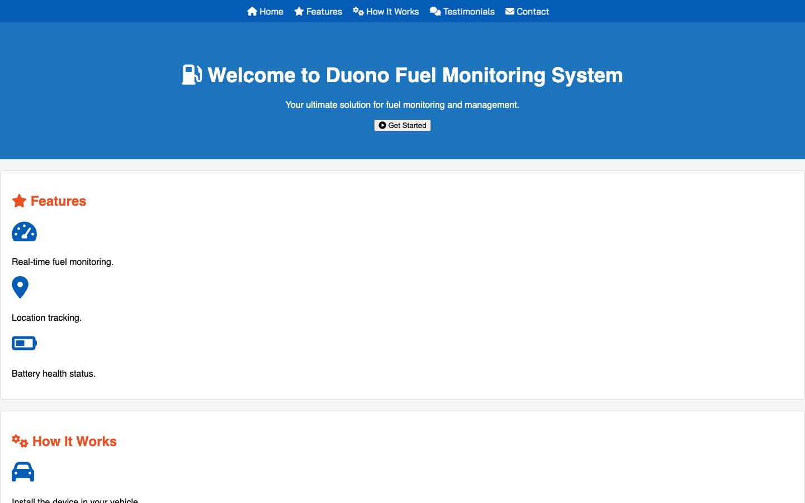

<p align="center"></p>

<p align="center"><a href="#screenshot">Screenshot</a> · <a href="#run-it">Run it</a></p>

## About

A landing page for DUPNO's vehicle fuel-monitoring service.

## What it does

- Hero with a call to action
- Features: real-time fuel monitoring, location tracking, battery health status
- How it works, testimonials and contact sections
- Responsive layout in plain CSS

## Screenshot

<p align="center"></p>

## Built with

HTML · CSS

## Run it

No build step. Open `index.html` in a browser, or serve the folder:

```bash
npx serve .
```

---

<p align="center"><sub>Made by <a href="https://github.com/Ehasan07">S M Ehasanul Haque</a> · Dhaka, Bangladesh · <a href="https://ehasanlive.com">ehasanlive.com</a></sub></p>
